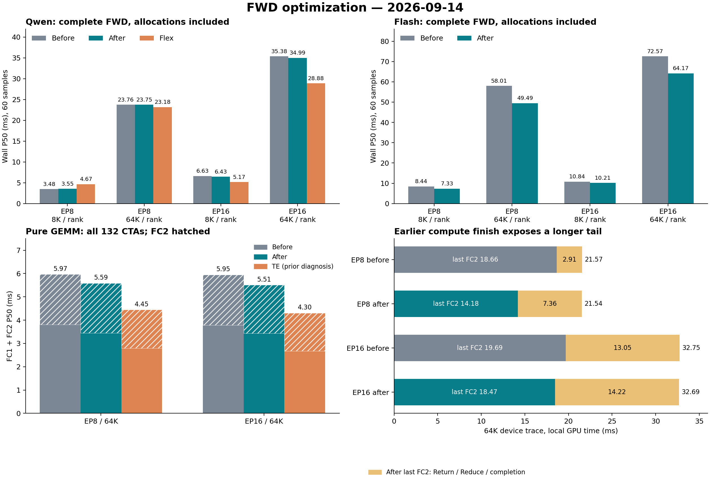
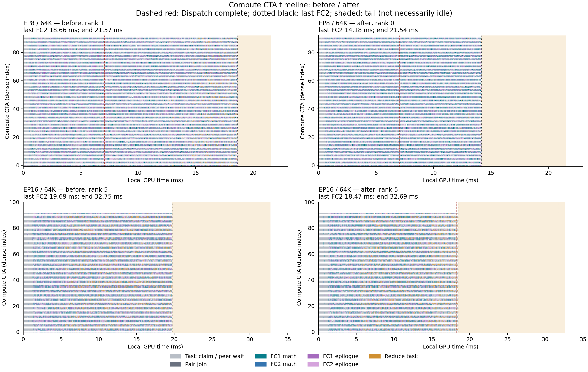

**FWD 优化与带宽复测，2026-09-14**

Qwen EP16/64K 的跨节点通信已经接近标称吞吐：完整融合 kernel 平均 **323 GB/s/节点（80.8%）**，纯通信探针的 Return 为 **335 GB/s/节点（83.7%）**。这限制了继续压缩当前通信路径的收益，但不能推广到 EP8：其节点内 Return 只有约 **120 GB/s/GPU**，尚不能据此认定接近硬件上限。

本轮已落地 FC1 epilogue、FC2 取任务、cluster 内任务交接和热点 Return 调度的改动。纯 FC1 延迟降低 **9.2–12.1%**；Flash 完整 FWD 降低 **5.8–14.7%**。Qwen 的均衡路由收益仍然有限，EP16 与 Flex 的差距还没有解决。所有正式性能数字都来自最终保留的代码，失败候选没有混入结果。

**带宽：区分单向节点吞吐、单 GPU 吞吐和实际传输量。**

每节点有 8 个逻辑 bond，每个对应两条活动的 200 Gb/s 物理链路，因此名义单向总带宽为 `8 × 2 × 200 / 8 = 400 GB/s`。没有把双向带宽相加。下表为 identity FWD 探针，保留生产资源分工，Dispatch 完成后再 Return；时间来自预分配 GPU 阶段区间，payload 不含协议头。

| Qwen 规模 | 吞吐统计范围 | Dispatch 时间 / 有效吞吐 | Return 时间 / 有效吞吐 | Return / 标称 |
|---|---|---:|---:|---:|
| EP8 / 64K | 每 GPU，排除本 GPU 数据 | 6.695 ms / 280.7 GB/s | 15.661 ms / 120.0 GB/s | 未作等价上限比较 |
| EP16 / 8K | 每节点单向 RDMA | 1.320 ms / 203.4 GB/s | 3.328 ms / 322.6 GB/s | 80.7% |
| EP16 / 64K | 每节点单向 RDMA | 8.786 ms / 244.4 GB/s | 25.651 ms / 334.9 GB/s | 83.7% |

EP16/64K 的实际 GIN payload 为每 GPU Dispatch 256 MiB、Return 1,024 MiB，每节点合计 **10 GiB**。最终完整 kernel 的 CUDA-event P50 为 **33.227 ms**，因此 `10 GiB / 33.227 ms = 323.15 GB/s`。这是整个 kernel 区间上的平均有效吞吐，不是 HCA 瞬时端口利用率；完整 FWD 含申请的 wall 时间另见下表。

对当前流量，即使理想用满链路，Return 仍至少需要 **21.475 ms**，Dispatch 加 Return 至少需要 **26.844 ms**。将 Return 从当前 83.7% 提升到理想 100%，最多节约该阶段约 **4.18 ms / 16.3%**，实际还要承担控制流量与局部搬运。不能把最后 FC2 后的 14 ms 全部算作可移除的同步浪费。

EP8 使用节点内链路，不能套用 RDMA 的 80% 结论。该硬件历史独立 IPC copy 探针达到过约 333 GB/s/GPU，但其 H=2560、路由与资源配置不同，只能说明硬件搬运仍有潜力，不能用它作为本次 Qwen Return 的等价上限。参见 [此前通信测量](../docs/communication_optimization.md)。

Flex 的流量也不同。[上一轮 HCA 计数与同版本源码核对](qwen_forward_diagnosis_20260914.md)显示，它先在节点内合并贡献，EP16/64K Return wire bytes 约 **269.5 MiB/GPU**；当前实现的有效 Return payload 为 **1,024 MiB/GPU**。两者统计口径分别包含／不包含协议头，不能当作精确压缩率，但约四倍量级的差异足以解释为何“分离 kernel”可以更快。旧 rank 级 pre-combine 的收益不能代表节点级合并；后者随 EP 改变浮点归约树，直接照搬会破坏当前跨 EP 的逐位一致性。

**实际保留的优化。**

1. **FC1 输出改为连续向量写入。** 用 STSM 将 WGMMA fragment 暂存到已有 shared memory，再以 `uint4` 连续写 S 和训练所需的 A/B checkpoint；每 lane 的两个 gate 提前加载，避免在各 N fragment 重复读取。先完成 BF16 A/B 舍入，再执行原来的 SwiGLU 和 gate 运算。完整 tile 使用快路径；尾块及 shared-memory 容量不足的配置保留原标量路径。复用 B 区之前等待两个 math warpgroup 都完成读取。
2. **FC2 用一个线性的 N-tile 游标领取成对任务。** 去掉每个 M-block 上会越领的 tile 原子计数；只有 descriptor 已发布才允许领取，不预占未就绪任务，保留 FC2 优先调度及原有数值顺序。
3. **CTA pair 的交接移到 cluster shared memory。** 使用 ready/joined mbarrier 的 release/acquire 与轮次 parity 保护元数据和生命周期，移除全局 mailbox、对应 pool 分配与 reset。H/I 使用经 host 校验的编译期 specialization 常量，减少地址计算；没有把实现硬编码为两个测试模型。
4. **已完成本 peer 工作的 Return CTA 可以接管其他 peer。** 常规队列仍在生产时保留原分工，完成后再接管热点，避免启动阶段把正常 batch 切碎。通知接收和 drain 同时支持所有 peer，避免跨 peer 等待形成死锁。归约顺序不变。

没有保留更多 relay CTA、激进抢占、Return TMA 预取、更宽 GEMM tile 或改变 WGMMA 等待深度等实验。它们在独立探针或完整 FWD 中没有稳定收益，部分明显回退。两种“Reduce 直接读取同节点 FC2 输出”的隔离候选也已排除；其中一个同时预取四个源、保持原累加顺序，EP8/64K 设备时间仍为 22.83 ms，弱于最终版 22.57 ms。两个直接读取候选均通过每 rank 20 次全输出重复检查以及与最终版的输出哈希比较，但没有获得稳定性能收益。没有恢复 pre-combine。

代码主要位于 [计算与 epilogue](../src/cuda/persistent_v3/forward/compute_kernel.cuh)、[Return 领取](../src/cuda/persistent_v3/forward/return_pipeline.cuh)和[接收与 drain](../src/cuda/persistent_v3/forward/dispatch_pipeline.cuh)。

**纯 GEMM：已改善，但大 M 下仍有明确差距。**

使用全部 **132 个 CTA**，前后两版各两轮、合并 60 次采样。微基准提取生产 WGMMA/TMA 主循环，包含 FC1 A/B BF16 checkpoint 写入和 FC2 epilogue；不含 SwiGLU、gate、路由、动态队列、通信及申请。输入预分配、任务静态配对。下表单位 ms，全部为 P50。

| Qwen 规模 | FC1 优化前 → 后 | FC1 延迟降低 | FC2 优化前 → 后 | TE FC1 / FC2 |
|---|---:|---:|---:|---:|
| EP8 / 8K | 0.450 → 0.398 | 11.6% | 0.265 → 0.261 | 0.408 / 0.264 |
| EP8 / 64K | 3.811 → 3.443 | 9.7% | 2.155 → 2.143 | 2.798 / 1.649 |
| EP16 / 8K | 0.446 → 0.392 | 12.1% | 0.270 → 0.265 | 0.375 / 0.240 |
| EP16 / 64K | 3.788 → 3.438 | 9.2% | 2.160 → 2.070 | 2.668 / 1.635 |

TE 列沿用同日上一轮的实际 TE CUDA Graph 诊断，取 EP 内每次最大值；Weft 独立探针在 GPU0 上运行。它是 kernel 差距参照，不是下表正式 wall 对比的替代。64K 两层合计为 Weft **5.586 / 5.508 ms**、TE **4.446 / 4.303 ms**（EP8 / EP16），仍慢约 **25.6% / 28.0%**。FC2 的改善小，特别是 K=512 的短主循环，其同步与 epilogue 开销仍明显。本轮没有靠改变累加顺序换取性能。

四种规模、两层、前后两版、两种运行顺序的全部微基准均进行了完整输出 cuBLAS 对照和再次运行的逐字节比较，共 32 组全部通过，当前测试输入最大绝对误差为 0。

**完整 FWD：申请计时与 Flex 配对复测。**

设备为两节点各 8 张 NVIDIA L20X、SM90a、132 SM。Qwen 为 H=2048、I=512、E=256、top-k=8；Flash 为 H=4096、I=2048、E=256、top-k=6，均为 BF16 routed-expert 训练 FWD，保留 routed X 与 FC1 A/B。**8K / 64K 都是每 rank token 数。**

两轮各 10 次预热、30 次测量，第二轮反转 case 与实现顺序；每次迭代取各 rank wall 最大值，合并 60 个样本，不剔除异常值。计入输入／路由／gate clone、输出及当次固定 tensor 申请、Notify 和完整 FWD 完成；不计一次性的通信 buffer、专家权重初始化、RDMA context。性能测量关闭重复校验，正确性单独运行。正式测量期间没有其他 GPU 工作或 CPU 编译并发。Flex 使用相同生成器、Megatron-Core 0.17.0、DeepEP 1.2.1+567632d、TE 2.14.1，两端 NCCL 2.31.2；Flex 通信 SM 为 EP8=80、EP16=48，沿用此前配置。

| Qwen 规模 | 优化前 | 优化后 | Flex | 优化后相对 Flex 耗时 |
|---|---:|---:|---:|---:|
| EP8 / 8K | 3.478 | 3.551 | 4.674 | -24.0% |
| EP8 / 64K | 23.760 | 23.753 | 23.176 | +2.5% |
| EP16 / 8K | 6.628 | 6.435 | 5.172 | +24.4% |
| EP16 / 64K | 35.380 | 34.987 | 28.884 | +21.1% |

单位均为 wall P50 ms。Qwen EP8/8K 回退约 **2.1%**，EP8/64K 基本持平；EP16 的延迟下降分别约 **2.9% / 1.1%**，还不能称为达标。

| Flash 规模 | 优化前 | 优化后 | 延迟降低 |
|---|---:|---:|---:|
| EP8 / 8K | 8.444 | 7.325 | 13.2% |
| EP8 / 64K | 58.014 | 49.486 | 14.7% |
| EP16 / 8K | 10.841 | 10.208 | 5.8% |
| EP16 / 64K | 72.568 | 64.166 | 11.6% |

Flash 本轮完成前后配对复测，没有重新跑 Flex，因此不据此声称 Flash 已追平或超过 Flex。大 GEMM 的收益能反映到完整 FWD，与 Qwen 当前通信占主导的结果一致。

**尾部：计算更早完成，通信仍在关键路径。**

以下均为独立 schema 9 设备 trace，每个 case 选该轮设备区间最长的 rank，时间零点仅在各自 GPU 内定义。它不包含 host 申请／Notify，测量边界也与上面的 CUDA event 不同。前后 trace 属于不同运行，不能作跨 GPU 时间戳相减。

| 64K 规模 | 版本 / rank | Dispatch 完成 | 最后 FC2 | 设备区间结束 | 最后 FC2 后区间 |
|---|---|---:|---:|---:|---:|
| EP8 | 前 / 1 | 7.054 | 18.657 | 21.571 | 2.914 |
| EP8 | 后 / 0 | 7.023 | 14.182 | 21.539 | 7.356 |
| EP16 | 前 / 5 | 15.575 | 19.692 | 32.745 | 13.054 |
| EP16 | 后 / 5 | 18.280 | 18.469 | 32.687 | 14.218 |

FC1 epilogue 的平均每计算 CTA 累计时间明显下降：EP8/64K **3.192 → 1.826 ms**、EP16/64K **2.903 → 1.703 ms**。EP8 的取任务／配对区间 **6.940 → 4.213 ms**；EP16 仍约 **6.8 ms**，包含通信 readiness 等待。这些是重叠执行中的累计区间，不能再与通信 envelope 相加计算总耗时，也不能将配对子项重复计入。

EP8 的最后 FC2 提前了约 4.47 ms，完整设备区间却近乎不变；EP16 也呈现同样趋势。因此优化后的长尾不是“新增同等长度的空转”，而是计算提前结束后，原有 Return/reduce 工作进一步显露。EP16 Dispatch 完成更晚，与更早产生的 Return 竞争同一网络资源相符，这是基于时间线的推断，尚未单独量化竞争比例。上一轮独立 Nsight Systems 采样中，EP16 无 Tensor 尾部仍有约 75.5% 的 PCIe 活动；本轮没有重新采集硬件计数，不能把旧采样与新 trace 逐点拼接。

另做了保持每专家行数的 self 路由对照：EP8/8K 设备 P50 **7.825 → 2.000 ms**，EP8/64K **38.468 → 15.742 ms**。本 peer 完成后接管其他队列解决了固定 peer 分工下的热点资源闲置；这说明一般路由分布下也有收益，不应只看均衡路由。前后输入、路由、gate、权重和输出哈希一致，每 rank 均完成 20 次全输出逐字节重复检查。它是路由控制实验，不代替正式均衡路由成绩。

**稳定性和一般性验证。**

- Qwen、Flash × EP8、EP16 × 8K、64K：FWD 与 BWD 每 rank 各 **25 次完整输出逐字节重复检查**，BWD 覆盖 dX、dgate、dW1、dW2，全部通过。
- FWD 129、513、8K、64K 的共同 129-token 前缀在不同 batch、不同 EP 之间逐字节相同，也与优化前一致；大规模全输出哈希与优化前一致。
- 重新分片 EP8×258 与 EP16×129 的相同全局输入，两个模型输出逐字节一致。小规模 BWD 的全部 dump 与此前独立验证过的参考快照逐文件一致。
- Graph 重放、交替保留／不保留训练中间量、多次改变路由分布通过既有测试。通用配置 H=2560、I=768、E=128、top-k=6、FC1/FC2 三个 stage，在 129／1025 token 的尾块和完整块组合下通过重复检查、batch 前缀检查及所抽取坐标的 FP64 参考比较。
- 新 trace 的全部 24 个 rank 无事件溢出、输出哈希与未追踪正式版一致。既有 autotune／relay Python 检查通过；源文件哈希与最终构建记录一致。

**证据与复现。**

[机器可读结果](forward_optimization_20260914.json)包含正式 wall／GPU 全样本、纯 GEMM 全样本、所有 rank 的 trace 汇总、带宽计算输入、验证结果、最终源文件 SHA256 和构建／运行记录路径。均值、P95 与离群值保留其中。原始日志和隔离候选位于 `results/fwd_optimization_20260914/`；`formal` 为配对测量，`pure_final` 为 GEMM，`validation` 为稳定性，`diagnostics` 为通信、trace、self 路由及通用尺寸。`before_source` 保存本轮开始前的源文件；未保留的候选只存在于隔离结果目录。

纯 GEMM 可通过 [提取构建器](run_forward_gemm_diagnostics.py)与 [harness](pure_forward_gemm.cu)复现；完整 FWD 使用既有 `run_performance_matrix.py`，本轮准确命令保存在每个日志及 manifest。不要把预分配的纯通信／GEMM 时间与含申请的 wall 成绩混用。
