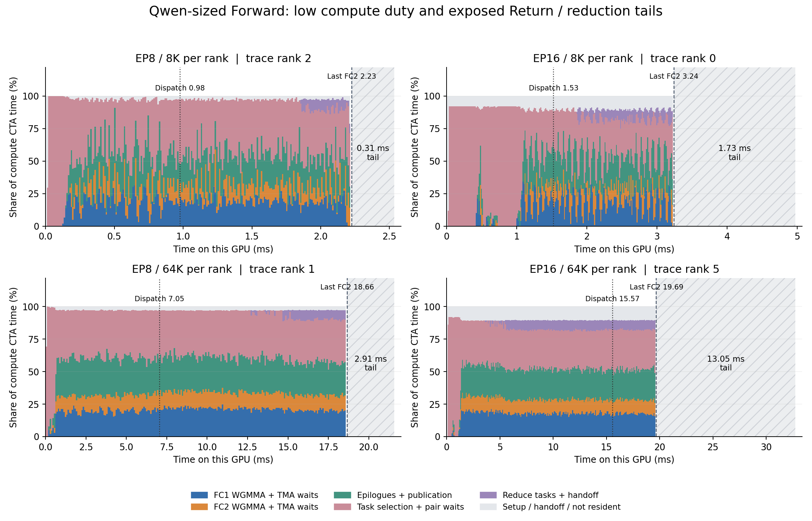
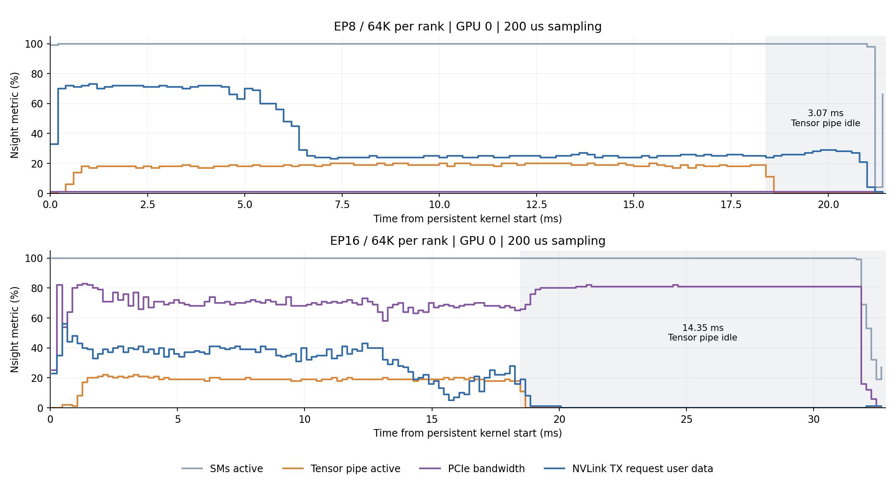

**Qwen 规模 FWD 性能诊断，2026-09-14**

主要瓶颈是当前通信路径、固定资源分工和逐 tile 调度；纯 GEMM 仍有优化空间，但不能解释完整 kernel 的大部分耗时。EP16、64K 在最后 FC2 完成后还有约 **13.05 ms** 的 Return/reduce 尾部。通信与计算确有重叠，但这段尾部仍暴露在关键路径上，不能据此认为减少通信量已经不重要。

测试对象为当前 `optimize` 的 `38b8797`，H=2048、I=512、E=256、top-k=8，BF16 routed experts。**8K/64K 均为每 rank token 数**；本测试不是整模型耗时。两端沿用相同输入、路由、gate 和专家权重生成器，保留 routed X 与 FC1 A/B 的训练 FWD 合约。设备为两节点各 8 张 L20X（SM90、132 SM）。NCCL 均固定为 2.31.2；Flex 为 Megatron-Core 0.17.0 + DeepEP 1.2.1+567632d + TE 2.14.1。沿用已选配置：Flex 通信 EP8=80 SM、EP16=48 SM；Weft 计算/通信 CTA 分别为 EP8/8K 108/24、EP8/64K 92/40、EP16 100/32。

**完整 FWD：公平的申请计时。** 两轮各 10 次预热、30 次测量，第二轮反转实现和 case 顺序。每次迭代取各 rank wall 时间最大值，再合并 60 个样本；不剔除异常值。计入输入/路由/gate clone、输出及当次固定 tensor 申请、Notify 和完整 FWD 完成；通信 buffer、权重、RDMA context 的一次性初始化不计入。下表均为未开启 profiler 的 wall P50，单位 ms；正号表示 Weft 更慢。

| 规模 | Weft | Flex | Weft 相对耗时 |
|---|---:|---:|---:|
| EP8 / 8K | 3.480 | 4.698 | -25.9% |
| EP8 / 64K | 23.818 | 23.199 | +2.7% |
| EP16 / 8K | 6.584 | 5.163 | +27.5% |
| EP16 / 64K | 35.302 | 28.897 | +22.2% |

EP8/8K 仍领先；其余三项落后。均值、P95、CV、全部样本及原始记录路径保存在 [机器可读结果](qwen_forward_diagnosis_20260914.json)。Weft 原有 `forward_us` 不含 Notify/输入准备，不能与 Flex 的完整 CUDA-event FWD 直接比较。Weft Notify P50 约为 0.67–1.57 ms，影响短序列，但无法解释 EP16 的设备尾部。

**纯通信：分别看申请计入的 identity FWD 和预分配 GPU 探针。** Weft 在测试构建中替换 GEMM，使用收到的 X 作为专家输出，仍走生产 Dispatch、Return、固定顺序 Reduce 与完成协议，保留生产 CTA 资源分配。关闭 backward-state 保留后，输出应为 8×X；这项数值检查已通过。Flex 跳过专家 MLP，保留实际 dispatcher 的 preprocess、permute、unpermute、DeepEP dispatch/combine。它们都包含各自实现要求的局部数据整理，并非相同网络工作量。

前两列计入申请、输入 clone、路由准备与 Notify/metadata。后两列用于拆解：Weft 为预分配 CUDA Graph，排除 Notify 和申请；Flex 为 identity 流程的阶段事件区间，仍含准备和申请，并有少量打点开销。**后两列不是同边界的达标分数**。通信探针采用 Dispatch 完成后再 Return 的顺序，不能拿它与完整融合 FWD 相减来计算“被隐藏的 GEMM 时间”，也不能把各阶段 envelope 相加。

| 规模 | Weft identity wall | Flex identity wall | Weft 预分配 GPU | Flex identity GPU |
|---|---:|---:|---:|---:|
| EP8 / 8K | 3.293 | 3.066 | 2.326 | 3.045 |
| EP8 / 64K | 23.351 | 17.058 | 21.948 | 17.038 |
| EP16 / 8K | 6.224 | 3.960 | 4.916 | 3.940 |
| EP16 / 64K | 36.798 | 22.876 | 35.084 | 22.855 |

64K 时，Weft identity 的 Return 区间约为 EP8 **15.51 ms**、EP16 **26.01 ms**。Flex 的本地 unpermute 约 4.5 ms，随后 DeepEP combine 约 4.5 ms（EP8）或 7.7 ms（EP16）。这些区间含等待，特别是 Weft 的 `reduce_us` 不是纯求和算术耗时。纯通信探针反映的是当前 FWD 资源分工下的协议吞吐，不是硬件链路带宽上限。

**EP16 的回传量差异是实测事实。** Weft 每 GPU 在 8K/64K 发送的 GIN Return payload 为 **128/1,024 MiB**；Dispatch payload 为 **32/256 MiB**。Flex 按两节点 HCA 计数器、每节点 8 GPU 平均，三次采样的回传 wire bytes 约为 **33.7/269.5 MiB**，包含协议头和少量 NCCL 控制流量。DeepEP 同版本源码先在节点内合并贡献再 RDMA 发送；按有效 payload 估计约为四倍差异，不能将 payload 和 wire bytes 的比值当作精确压缩率。

所以 Flex 不是只将同一份通信拆成几个 kernel。旧 owner/rank 级预合并与这种节点级合并不是同一范围；不能由旧选项收益小推导出通信量不重要。DeepEP 的分层浮点归约也不自动满足我们跨 EP 的 batch invariance，不能直接替换当前归约顺序来获得这部分加速。

另核对了物理链路：每个 `mlx5_bond_*` 对应两条活动的 200 Gb/s 成员链路；verbs 的 `rate` 文件只显示 200 Gb/s。每节点名义总带宽应按 8×2×200 Gb/s 理解，不能用 8×200 Gb/s 计算利用率。原始成员信息与 HCA 采样在结果目录中。

以 EP16/64K identity 的 Return 区间估算，每节点 8 GiB payload / 26.01 ms ≈ **330 GB/s**，约为名义 400 Gb/s × 8 = 400 GB/s 的 **83%**。这是阶段平均有效 payload 吞吐，不是端口瞬时利用率。即使理想用满全部链路，当前 Return payload 也需要至少约 **21.47 ms**；Dispatch 加 Return 共 10 GiB 的累计发送下限约 **26.84 ms**，尚未计入协议与局部搬运。大规模下，回传量本身已经形成明显带宽约束，不能期待只改任务队列就消除全部差距。

**纯 GEMM：隔离主循环、通信和 Python launch gaps。** Weft 使用当前生产 FC1 双投影与 FC2 WGMMA/TMA 主循环、FC1 A/B BF16 store 和 FC2 TMA epilogue；静态配对任务，不含 SwiGLU、路由、动态队列、通信与申请。输入 M 精确等于本次均衡路由的每专家行数：2,048/16,384（EP8）和 4,096/32,768（EP16）。TE 使用实际 dispatch 得到的输入和 counts，分别捕获其 FC1/FC2 CUDA Graph，排除 Python 逐专家发射间隙。以下是 kernel 诊断，**不替代上面的含申请 FWD 计时**。

| 规模 | Weft FC1 / FC2，132 CTA | TE FC1 / FC2 | 两层合计 Weft / TE | Weft 仅使用 FWD 计算 CTA |
|---|---:|---:|---:|---:|
| EP8 / 8K | 0.450 / 0.266 | 0.408 / 0.264 | 0.716 / 0.672 | 0.820（108 CTA） |
| EP8 / 64K | 3.787 / 2.181 | 2.798 / 1.649 | 5.968 / 4.446 | 7.488（92 CTA） |
| EP16 / 8K | 0.446 / 0.269 | 0.375 / 0.240 | 0.716 / 0.615 | 0.889（100 CTA） |
| EP16 / 64K | 3.803 / 2.190 | 2.668 / 1.635 | 5.993 / 4.303 | 7.079（100 CTA） |

Weft 数字来自 GPU0 两种实现顺序的各 30 次采样；TE 数字取 EP 内每次最大值。cuBLAS strided-batched 另作相同输入的数值和微基准对照，没有用它冒充 TE。已用可复现的新工具补做四个规模的 FC1/FC2 **全输出** cuBLAS 比较与重复运行逐字节比较，全部通过。当前测试输入下最大绝对误差为 0。

纯 GEMM 的 FC1 约 570–610 TFLOPS，FC2 约 490–520 TFLOPS；64K 两层比 TE 慢约 34–39%。仅固定计算资源分配就把 Weft 的合计从约 6 ms 增至 7.1–7.5 ms。Nsight Compute 的 EP16/64K 独立探针中 Tensor Pipe Active 约 FC1 71%、FC2 56%，barrier 是最大的 warp stall 类别；它包含 producer/consumer 和 cluster 等待，不能把 stall 比例直接等同可消除的墙钟时间。FC2 的短 K=512 下，流水线与 store/同步成本尤其值得优化。NCU replay 污染的宿主计时未纳入上述性能数字。

**完整 kernel 的 timeline。** 已增加每个 FC1/FC2 task 的 math、epilogue、取任务/配对边界，以及当前 GIN ring 的 pack、send、receive 标记。还修正了旧 Dispatch 标记在 streaming transport 完成 Return 后才记录的问题；以下使用 schema 9 的真实 Dispatch 完成点。每行选该轮设备区间最长的 rank，时间零点在该 GPU 内；不跨 GPU 比较 globaltimer。

| 规模 | trace rank | Dispatch 完成 | FC1 首次–最后 | FC2 首次–最后 | 设备区间结束 | 最后 FC2 后尾部 |
|---|---:|---:|---:|---:|---:|---:|
| EP8 / 8K | 2 | 0.977 | 0.121–2.206 | 0.180–2.226 | 2.534 | 0.308 |
| EP8 / 64K | 1 | 7.054 | 0.176–18.638 | 0.269–18.657 | 21.571 | 2.914 |
| EP16 / 8K | 0 | 1.526 | 0.417–3.223 | 0.473–3.243 | 4.974 | 1.731 |
| EP16 / 64K | 5 | 15.575 | 0.506–19.672 | 0.561–19.692 | 32.745 | 13.054 |



FC1/FC2 首尾跨度包含两种任务交替执行、排队和穿插的 Reduce，不能当纯 GEMM 时间。逐 CTA 累计后，截至最后 FC2 完成的平均占用如下（ms/计算 CTA）；“取任务/配对”已经包含配对等待，不能再重复加子项。

| 规模 | WGMMA/TMA math 区间 | Epilogue/发布 | 取任务/配对 | Reduce task/交接 |
|---|---:|---:|---:|---:|
| EP8 / 8K | 0.618 | 0.512 | 0.984 | 0.029 |
| EP8 / 64K | 5.906 | 4.938 | 6.940 | 0.310 |
| EP16 / 8K | 0.663 | 0.542 | 1.584 | 0.102 |
| EP16 / 64K | 5.297 | 4.357 | 6.786 | 1.104 |

EP8/64K 在 7.05 ms 收齐输入后，到 18.66 ms 最后 FC2 完成之间，仍有 **34.7%** 的计算 CTA 时间处在取任务/配对区间；EP16/64K 的对应比例为 **30.7%**。这排除了“这些等待全部是在等输入网络”的解释。计数队列争用、配对交接、FC2 优先级与 readiness 传播需要进一步分别优化。源码中的单 tile 调度、全局 mailbox 和完成计数可直接对应这些区间；本次没有把它们强行拆成无法由现有探针区分的单项耗时。



Nsight Systems 的独立 rank0 采样再次确认：EP16/64K 整段 SMs Active 平均约 **98.2%**，Tensor Pipe Active 仅 **10.2%**；计算活跃部分也只有约 **18.5%**。最后约 **14.35 ms** Tensor 采样已经接近零，PCIe 仍约 **75.5%**。这与设备 task trace 的约 13 ms 尾部一致；两图来自不同运行/不同 rank，不能逐点拼接，200 µs 采样也只适合观察趋势。EP8/64K 同样有约 3 ms 的无 Tensor 尾部，期间仍在做 NVLink Return/reduce。

还有一项资源放置现象：EP16/8K 的某些运行请求 100 个计算 CTA，实际只有 92 个执行 GEMM；其余 8 个直到尾部才进入。trace 显示部分 two-CTA cluster 延迟驻留；结合与 32 个非 cluster transport CTA 并发的启动布局，推测存在 cluster 放置造成的资源碎片，尚未用调度器指标单独验证。可用计算资源的减少不足以解释全部差距。

**路由控制实验给出的约束。** 使用相同 trace 构建、保持每专家行数和 GEMM 尺寸：EP16/64K 原始路由的 GPU P50 33.95 ms，节点内路由 26.62 ms，仅本 rank 路由 21.93 ms。改变路由会同时改变局部流量和队列分布，差值不是独立 RDMA 延迟，但确认了跨节点路径的实际影响。

EP8 的 self 路由反而从 2.71/22.49 ms 恶化到 7.98/38.75 ms（8K/64K）。trace 确认固定 peer Return 队列只让 **3/5 个 CTA** 搬运这个热点 peer，其余复制资源不能接管。这是明确的路由分布敏感问题，也解释了为什么单看均衡形状不足以保证一般性。

**建议的优化顺序。**

1. 优先改 Return 的资源调度和搬运链路：peer 热点允许其他 CTA 接管；计算结束后让空出的计算资源参与 Return/receive；检查能否减少 FC2 输出到 GIN staging、再到 contribution 的中间搬运。保留每 token 的确定性归约次序。
2. 改逐 tile 调度：批量领取或预取任务、减少全局计数和 mailbox 往返，在全部输入 ready 后仍能降低交接成本；同时核对 cluster 实际驻留，而不只看请求的 CTA 数。优化 epilogue/发布和穿插 Reduce 的粒度，避免仅一个 warp 工作却长期占住完整计算 CTA。
3. 再用同样的独立 TE/Weft 探针优化 FC1/FC2，重点处理 FC2 短 K、TMA store 与下一 tile 的流水重叠。每次把改动带回完整 kernel 评估，不能用微基准 TFLOPS 替代端到端收益。
4. 若再次探索通信量缩减，分组和归约树必须由全局 expert 编号定义，并独立验证跨 EP batch invariance。不能为了贴近 DeepEP 数字直接采用随节点/EP 变化的部分和。

本次改动仅用于诊断和修正 trace 语义，没有改动数值计算、归约顺序或 BWD 数据路径。schema 9 的四组 FWD 每 rank 均完成 20 次全输出逐字节重复检查，与未追踪生产版的输出哈希一致，所有 trace 无溢出；通信 identity 四组每 rank 完成 40 次全输出重复检查及精确 8×X 前缀验证。51 项 Python 测试及 54 个子用例通过。本次没有重复跑完整 BWD 稳定性矩阵，也没有将本次诊断称为性能优化已完成。

代码落点：[计算调度与 epilogue](../src/cuda/persistent_v3/forward/compute_kernel.cuh)、[本机 Return 的 peer 分工](../src/cuda/persistent_v3/forward/dispatch_pipeline.cuh)、[跨节点收发与 relay](../src/cuda/persistent_v3/forward/gin_transport.cuh)、[DeepEP 同版本节点内合并源码](../results/qwen_fwd_diagnosis_20260914/deepep_internode_567632d.cu)。

**复现与原始数据。**

完整记录在 `results/qwen_fwd_diagnosis_20260914/`：`short/long` 为两轮未追踪对比；`ep*_schema9` 为全部 rank 的设备 trace；`ep*_nsys` 包含 Nsight Systems 报告和 SQLite；`ep*_flex` 包含实际 TE CUDA Graph 时间、Chrome trace、逐阶段全部 rank 样本和 HCA 计数；`pure` 保存微基准所有样本及 NCU 报告；`pure_verified` 保存全输出验证。每个测量日志保留完整命令。`invalid_retained_*` 为弃用的 identity 配置试验，不参与报告统计；旧 schema 8 的 Dispatch 标记不参与最终 timeline 分析。

可复现工具为 [Forward 诊断](forward_diagnostics.py)、[生产 GEMM 提取构建器](run_forward_gemm_diagnostics.py)、[纯 GEMM harness](pure_forward_gemm.cu)，以及既有 `run_performance_matrix.py`、`tools/analyze_device_timeline.py`。例如：

```bash
/opt/.venv/bin/python3 benchmarks/run_forward_gemm_diagnostics.py \
  --profile configs/performance_20260913/qwen_ep8.hpp \
  --output-dir results/qwen_gemm_reproduce
LD_LIBRARY_PATH=/usr/local/cuda/compat:/usr/lib/x86_64-linux-gnu:/usr/local/cuda/lib64 \
  results/qwen_gemm_reproduce/pure_gemm fc1 32768 1024 2048 16 0 132 0 0
```

Flex 在原有训练 FWD 基准命令上加 `--forward-diagnostics-dir DIR`；两节点 RDMA launcher 已透传此参数。Native trace 使用 `WEFTMOE_DEVICE_TIMELINE=1` 构建和 `WEFTMOE_DEVICE_TIMELINE_PREFIX` 输出；Nsight 可用 `WEFTMOE_PROFILE_LAST_ROUND=1` 配合 CUDA profiler capture range。通信 identity 的 retained-state 环境开关按“是否存在”解释，必须移除 `WEFTMOE_FORWARD_BENCH_RETAIN_STATE`，设置成字符串 `0` 不会关闭它。
