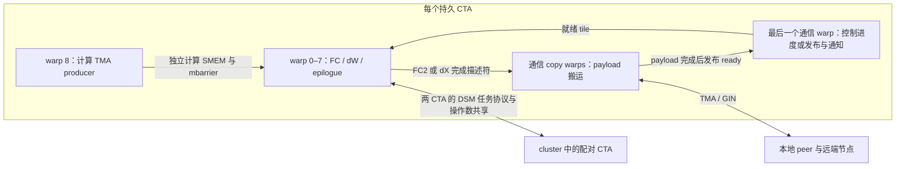

# 全 CTA 计算与通信 worker

本文描述当前源码中的统一 worker 路径。它将计算、NVLink 搬运和 GIN/RDMA 进度放入同一个持久 CTA，通过 warp 分工重叠执行。普通 C++ 构建默认启用 FWD/BWD，四份公开 autotune JSON 的 `unified_workers` 也为 `[1]`。两个阶段仍可分别选择原布局；旧生成配置缺少某阶段开关时继续将该阶段关闭，避免重编历史配置时改变路径。[9 月 14 日性能矩阵](../benchmarks/full_cta_all_worker_20260914.md)对应当时的 4 槽配置：BWD 八项均优于历史同频 main，FWD 仍有回退，尚未达到全面领先的目标。

本文介绍实现与资源约束。配置方法见[公开配置说明](../configs/README.md)，调参入口为 [FWD CLI](../tools/autotune_forward.py) 和 [BWD CLI](../tools/autotune_backward.py)。[9 月 15 日 8 槽配置](../configs/full_cta_all_worker_20260915/README.md)保存当前完成位图 ACK 版本的组合头、源码校验值和验证范围；两模型 EP16、8K/64K 的 FWD/BWD 检查已完成，原始样本见[通信改动报告](../benchmarks/ring_depth_20260915.md)。本轮未重跑正式 EP8 性能矩阵。[9 月 14 日配置](../configs/full_cta_all_worker_20260914/README.md)作为历史版本保留。

## CTA 内的分工

统一路径按设备实际 SM 数启动 `SM_count & ~1U` 个 CTA，并组成两 CTA 的 cluster。在本次使用的 132 SM L20X（SM90a）上，每 GPU 是 132 个 CTA、66 个 cluster；132 不是模型或 EP 写死的常量。host 检查 cluster occupancy，要求这些持久 CTA 可以同时驻留。

每个 CTA 都有两个计算 warpgroup、一个 TMA producer warp，以及自己的通信域。通信不再永久占用一批没有计算 warp 的 CTA。不过，所有 SM 都具备发出 WGMMA 的能力不等于 Tensor Core 始终忙碌：输入就绪、tile 数量、producer 发射速度和尾部依赖仍可能造成空闲。

当前未覆盖配置的默认布局为 384 threads：

| CTA 线程 | warp | 工作 | 默认每线程寄存器配额 |
| --- | --- | --- | ---: |
| 0–255 | 0–7 | 两个 math warpgroup：WGMMA、activation/epilogue、FWD Reduce | 216 |
| 256–287 | 8 | 计算 TMA producer、计算域任务/阶段协议 | 64 |
| 288–351 | 9–10 | 两个通信 copy warp：FWD 按 CTA 职责执行 RDMA packing 或 relay 搬运；BWD 保留混合循环 | 64 |
| 352–383 | 11 | FWD RDMA CTA：GIN 控制；relay CTA：FC1 发布、通知消费；BWD：就绪任务发布、通知消费 | 64 |

最后 128 个线程属于同一 warpgroup，必须先统一执行寄存器释放，再分成独立的 producer 和通信循环。寄存器额度只能按 warpgroup 设置；warp 8 不能单独拿到不同于 warp 9–11 的额度。



本地 payload 采用分段 TMA global→shared→global。计算 SMEM 与通信 staging 同时存在，通信不能借用仍被 WGMMA 消费的操作数区域。路由、计数、通知和归并仍包含标量/向量指令；TMA 只负责搬运，不能替代 activation、gate 乘法或 Reduce 加法。

GIN 的 context、ring 和租约保持有限且共享。FWD 的 `unified_rdma_ctas` 将通信域划分为 RDMA 与 relay 两组，不减少任何 CTA 的计算 warp。正值指定 RDMA CTA 数，上限按实际 CTA 数截断，至少保留一个 relay；单机全部为 relay。宏缺省值为 16，旧 autotune 配置补 0 保留混合循环，公开网格也暂时固定 0，待性能筛选后再更新 incumbent。

RDMA CTA 的 copy warps 只打包，最后一个 warp 独立处理 GIN 提交、ACK 和完成。一个 shared-memory mailbox 用 release/acquire 交接不可变任务描述符；copy warps 完成 TMA 与 metadata fence 后，通过原 device-scope pending slot 发布打包完成。控制 warp 在打包期间继续推进其他已就绪槽。relay CTA 负责本地 Dispatch/Return、GIN 接收和 NVLink fanout，并按 relay ordinal 独占 FC1 输入组。

FWD relay 的最后一个 warp 交替进行有限 FC1 发布和 Return 通知接收。每 channel 只有一个通知消费者，入口固定完整 warp 和 lane 0，不以瞬时 activemask 重新选主。copy warps 等待 credit 时不再辅助接收；原 TMA 完整完成、发送线程同步、system-release ready、system-acquire 接收的顺序保留。BWD 暂时保留原混合 worker 与 CAS 通知接收协议；共同 helper 的默认参数保持该语义。本轮逐步提交、短测及失败候选记录见 [通信分区记录](../benchmarks/communication_partition_20260915.json)。

每个 context 默认有 3 个 packing 槽。FWD 可为同一 channel 预留多个有界 packet，交给不同 CTA 在租约外打包；提交时仍要求 packet sequence 等于 channel 的下一待发送序号，不能按打包完成顺序发送。预留 terminal 后停止为该 channel 领取后续 packet，credit 检查覆盖预留序号。BWD 复用同一协议核心，但仍限制每个 channel 同时只有一个未提交 packet；其余槽可服务该 context 的其他 channel。

上述 packing 槽保存待打包/待提交任务，与每 channel 的物理 ring 槽不同。物理深度由共享参数 `gin_ring_depth` / `WEFTMOE_GIN_RING_DEPTH` 控制，可选 4、8、16，新公开配置与裸构建默认 8。任务提交后即可释放 packing 条目；物理 TX/RX 槽要等本地发送完成 counter 和接收端消费后的 credit 才能复用。此前 slots4/slots6 实验只改变 packing 槽数，9 月 14 日最终矩阵及其冻结配置的物理深度仍为 4；本轮扩大物理深度的结果须单独记录。

深度同时决定全局显存中的 TX/RX payload 和 control 布局、local completion counter 数量以及最终 drain 检查范围，不增加 CTA shared memory。FWD/BWD 与新旧 worker 路径必须共享同一深度，所有 rank 也必须使用一致的编译配置。旧 plan 或 build record 缺少该参数时补 4；旧生成头（包括 `-include` profile）缺少宏时也保留 4，避免重编历史配置静默换布局。旧 profile 可显式前置 `#define WEFTMOE_GIN_RING_DEPTH 8` 或 16 来扩大窗口，其余字段不必重写。

ACK 使用每 channel 一个 64-bit dirty bitmap 跟踪已经消费、尚待确认的物理槽。RX worker 完成原 payload 搬运后，先 release 写入该槽的 consumed 代次，再用 release atomic OR 设置对应 bit。ACK owner 在 context lease 内先检查 bitmap：空值直接返回；非空时通过 acquire exchange 取走并清零当前 mask，只遍历其中的 set bits，逐个发送 credit 并推进原 acknowledged 代次。旧布局仍由其唯一 GIN owner 执行同一算法。

bitmap 复用 channel 原有 padding，不增加注册显存或 CTA shared memory，也不改变物理 slot、payload 和 counter 的偏移。发送方仍须同时满足同槽上一代的 local completion counter 和远端 credit，才能复用 TX/RX 槽。一个槽的下一次 completion 必须在上一代 credit 发出后才能发生，所以不会把两次尚未确认的 completion 合并为一个 bit；exchange 后到达的新 bit 保留给下一轮 ACK。

bitmap 减少空轮询和逐槽扫描的控制开销，不减少 payload 数据量，也不改变 payload-before-ready、TMA 完成或 credit 的正确性条件。generation 结束时仍执行原 drained 检查，核对每个槽的发送/接收代次与已归还 credit。bitmap 与 sent/claimed/consumed/acknowledged 一样属于持久窗口状态，初始化新窗口时清零，普通 FWD/BWD prepare 和 Graph 重放不额外清零。

两个 copy warp 继续共同处理 GIN 和本地搬运，ACK 仍由原 context owner/lease 协议保护。publisher warp 独立推进 GIN service 的候选没有启用；bitmap 优化没有改变 warp 分工或削弱 TMA 同步。

## 512 / 640 threads 与寄存器池

`unified_threads`、`unified_comm_base` 和 `unified_comm_threads` 可以改变布局。当前 Python 搜索器接受 384、512、640 threads。计算域仍是 256 个 math threads 加一个 producer warp；额外线程可以提供独立的通信 warpgroup。通信范围必须从线程 288 以后开始、按完整 warp 对齐，且位于 CTA 内。

例如，`comm_base=384`、`comm_threads=128` 对应一个完整通信 warpgroup；640 threads、`comm_base=384`、`comm_threads=256` 对应两个通信 warpgroup。通信域最后一个 warp 负责发布/通知，因此两者分别有 3 和 7 个 copy warp。producer warpgroup 未分配实际角色的 warp 仍须参加统一的寄存器释放，不能从资源算式中省略。

设 CTA 线程数为 `T`，math、producer 和额外 control warpgroup 的每线程配额分别为 `Rm`、`Rp`、`Rc`。请求的 CTA 寄存器总量为：

```text
requested = 256 × Rm + 128 × Rp + (T − 384) × Rc
nominal_initial = floor(65536 / T / 8) × 8
nominal_pool = T × nominal_initial
```

`producer_registers=0` 表示跟随 control 配额。producer 和通信共享第三个 warpgroup 时，必须有 `Rp=Rc`。独立 producer 配额目前只在 FWD 中实现；启用统一 BWD 时要求 `Rp=Rc`。

| 线程数 | 名义初始寄存器/线程 | 名义 CTA 池 | 一个通过算式的 `Rm/Rp/Rc` 示例 |
| ---: | ---: | ---: | --- |
| 384 | 168 | 64512 | 普通构建默认 `216/64/64`；BWD JSON 首候选为 `224/56/56` |
| 512 | 128 | 65536 | `192/64/64`；FWD 独立 producer 可用 `208/32/64` |
| 640 | 96 | 61440 | FWD 独立 producer 可用 `160/32/64` |

这些示例只说明寄存器算式成立，不保证特定 GEMM tile 无 spill、SMEM 可容纳或性能更好。当前 CUDA 12.9 构建下，超过 384 threads 的候选还要求 `wgmma_n256_atom_n=128`，用两个 N128 指令原子实现 N256 tile，绕开较低静态寄存器上限下的 N256 指令分配限制。该参数改变指令原子分解，不等于把所有 GEMM tile N 改成 128。

仅检查 `requested <= 65536` 不够。`setmaxnreg.inc` 从 CTA 初始池取得寄存器，池不足可能让 math 等待无法归还的寄存器。每个额度必须是 24–256 内的 8 的倍数；math `.inc` 不得低于原额度，producer/control `.dec` 不得高于原额度。同一 warpgroup 的所有 warp 必须一致执行该指令。指令语义见 [NVIDIA PTX：setmaxnreg](https://docs.nvidia.com/cuda/parallel-thread-execution/index.html#miscellaneous-instructions-setmaxnreg)。

实现分两层检查：

1. [公共资源模板](../src/cuda/unified_worker_tuning.hpp) 和 [Python 校验](../tools/unified_tuning.py) 检查上述名义池、额度方向、线程范围和 warpgroup 约束。
2. [host launch](../src/cuda/activation_transport.cu) 对实际 kernel entry 查询 `cudaFuncGetAttributes.numRegs`，按 Hopper 每 warp 256 寄存器的分配粒度，得到 `actual_initial=ceil(numRegs/8)×8`，再检查 `requested <= actual_initial×T` 和 `.inc/.dec` 方向。成功结果按 backend 生命周期、kernel entry 和各额度缓存，避免每次执行为此新增属性查询。

编译报告还要检查实际统一 entry 的 `USETMAXREG`、local load/store 和 spill。local/GIN、保留 BWD 状态与否可以产生多个 specialization；不能把同一二进制中仍存在的旧布局入口当作统一入口的证据。较大的 stack 也可能来自冷路径参数副本，应结合 SASS 中的位置及 timeline 判断。

## 编译器流水线与实际 spill

寄存器压力可能先表现为编译器将 WGMMA 串行化，不能仅凭 GEMM 内循环没有 `LDL/STL` 就排除。检查应同时记录热 K 循环的 local-memory 指令、WGMMA 的 ARRIVE/COMMIT/WAIT 分组、编译警告，以及实际 `USETMAXREG`。

在 CUDA 12.9 的本次构建中，发现了两项相互独立的问题：

- FWD 的 GIN specialization 内，NCCL EFA 分支中的外部 device assertion 调用使编译器在每条 WGMMA 后插入等待，即使实际运行使用另一个 GIN backend。当前封装仅在 NCCL device 头文件包含范围内，将断言失败处理替换为内联 `trap`；原断言条件保留，所有 backend 仍可编译。普通构建失败时仍产生 CUDA device fault，但错误文本与详细程度会改变；`WEFTMOE_DEBUG_VALIDATE=1` 保留原断言诊断。host 与封装外的断言不变，也不定义全局 `NDEBUG`。
- BWD unified activation GEMM 的 `wait1` 配合累加器活跃区间触发了 WGMMA pipeline 寄存器资源警告，使 activation 和 dW 都逐条等待。统一同步策略改为每个 K64 指令组 `wait0`，随后释放当前 TMA stage；legacy 策略仍在下一组完成后释放前一 stage。两者使用同一个 GEMM helper，累加顺序不变，stage 必须恰好释放一次。

隔离候选中，Qwen remote FWD 从 40 条 WGMMA / 40 次 ARRIVE / 40 次 WAIT 恢复为 40 / 10 / 9；BWD 从 48 / 48 / 48 恢复为 48 / 12 / 12，四个数学 K 循环没有 local load/store。这些是编译产物的观察，不代表相同比例的吞吐收益；通信和调度仍会限制完整 kernel。

## Shared memory 与同步域

FWD 动态 SMEM 的布局为：

```text
align128(compute_smem_bytes(world))
+ sizeof(CommunicationShared)
```

计算 arena 根据 FC1/FC2 的 tile、stage 和 FC2 多 tile epilogue 存储需求取最大值，再附加计算 mbarrier 和少量 metadata。BWD 同样先按 dAB/dX/dW 的最大存储需求分配计算 arena，再对齐放入自己的通信结构。两阶段使用各自的 `sizeof` 与资源配置。

通信 staging 的主要成本为：

```text
copy_warps = comm_threads / 32 − 1
staging_bytes = copy_warps × segment_bytes × copy_buffers
```

此外必须计入每个复制流/预取槽的 barrier、队列游标、Return peer 信息、GIN 临时状态、对齐和 kernel 静态 SMEM。例如，96 个通信线程、4096-byte segment、两个 buffer，仅 staging 就需要 16 KiB。不能只把它与名义 GEMM 操作数大小相加。

普通构建默认 FWD 两个 buffer、BWD 一个 buffer。保留的 H7168/I3072 默认计算形状下，Python 保守上界分别为约 210.75 KiB 和 218.63 KiB（EP16），均可容纳。显式共用 `WEFTMOE_UNIFIED_COPY_BUFFERS` 会覆盖两阶段的缺省值，而显式 phase 宏优先于共用宏。

Python 用对齐后的计算存储、staging、512-byte 控制区和 2048-byte 静态存储留量筛查；host 再使用实际动态 `sizeof`、CUDA 资源属性和 cluster occupancy 校验。当前 Hopper 单 CTA 上限按 227 KiB 约束。靠近上限时，新增几个 barrier 或扩大 tile 都应重新审实际编译资源。

减少某个 GEMM 的 stage 不一定释放 SMEM：如果另一个阶段或 epilogue 决定 arena 最大值，总量不会改变。扩大通信 buffer、增加 copy warp 和提高数学 tile 都会争用同一个 CTA 的容量。

同步域按参与者隔离：

| 物理 named barrier | 统一路径的用途 |
| --- | --- |
| 0 | 全 CTA 初始化/汇合；不用于持久计算任务就绪协议 |
| FWD 1 / 2 / 3 / 4 | TaskDone / MathReady / MathDone / TaskReady；计算任务域为 288 threads，数学域为 256 threads |
| BWD 1 / 2 / 3 | 两个数学屏障与 288-thread 计算域屏障 |
| FWD 7 | 末尾 Reduce 域的领取、归并及完成汇合 |
| 8 | 通信 copy warp 域 |
| 9 | 完整通信域初始化/退役汇合 |
| FWD 10 / 11 | math Return-row publisher 的分组、前缀和 reserve/fill/confirm 协议 |
| 6 | 可选本地 Dispatch/Return 分域中的 Return；Dispatch 保留 8 |

单 warp 通信子域使用 `__syncwarp()`。TMA 的 transaction barrier 和 cluster DSM mailbox 的 mbarrier 另有自己的 SMEM 存储与相位，不应与 named barrier ID 混为一谈。计算循环中的 cluster join 只等待计算域，通信必须能继续供应它正在等待的数据。

通信搬运有三类不同的等待：G2S 必须在 transaction mbarrier 完成后才允许 S2G 读取；复用 staging 前等待旧 S2G 不再读取 shared memory；整个 chunk 结束时，issuing lane 执行 global `wait_group 0` 和 system fence，再由 copy 域同步传递完成状态，随后才能发布 ready 或 RX consumed。最后一类等待保证目标可见性，不能用仅检查 shared-read 完成的等待替代。默认 EP16 的两个 copy warp 共享这条任务循环，一类搬运等待时会推迟同 CTA 的其他通信服务；数学 warpgroup 不参加该 64-thread 屏障，仍可继续计算。现有 PackStart→End trace 同时包含 metadata、TMA 与同步，不能据此单独认定 fence 占据多少时间。

上述 10/11 来自[公共 Return 队列发布器](../src/cuda/communication/return_queue.cuh)的 CUTLASS 用户编号 2/3，后者会加上保留编号偏移 8；不是计算域直接使用的物理 2/3。[末尾 Reduce](../src/cuda/persistent_v3/forward/reduce_pipeline.cuh)则显式选择物理 7。

角色在入口处分离，各自进入持久循环，避免编译器把数学与通信的活跃变量合入同一个反复汇合的任务循环。FWD 结束时先让 math 完成固定顺序的 Reduce，同时通信继续排空；所有 CTA 线程汇合后再执行 cluster join，保护 DSM mailbox 生命周期。BWD 则由计算域执行终结 DSM 握手，通信域独立排空；它不在每个任务边界插入全 CTA 屏障。

## 确定性与退役后的工作复用

改变 warp 所属 CTA 不改变数学契约。任务调度只改变独立 tile 或 token 的执行先后，不能改变同一个输出的累加次序。

- **FWD GEMM 与 activation：** FC1 的 FP32 累加、BF16 舍入、SwiGLU、route gate 乘法以及 FC2 输入/输出舍入保持原有路径。两 CTA 的操作数共享和 N128 原子分解必须保持各元素的 K 累加次序。
- **FWD Reduce：** 返回的是独立 route 结果。每个 token 只有一个 claim owner，按 `combine_order` 定义的固定专家/route 顺序做 FP32 归并，不按通信到达顺序求和。计算边界可以让 `opportunistic_reduce_warps` 个 math warp 各尝试领取 ready token；未就绪的 token 不能被提前消耗，尾部完成计数仍覆盖所有已领取工作。TMA 无法替代这一步加法。
- **BWD：** dAB/dX、activation 梯度、dW1/dW2 复用原数学例程。每个 dW 输出 tile 保持单一 owner 和固定 K 遍历顺序；执行该 tile 的 CTA 可以由调度决定，不引入跨 CTA 的浮点原子归并或动态 split-K。最终 dX 同样按 `combine_order` 定义的固定专家/route 顺序求和。
- **可见性与唯一 owner：** payload 的 TMA 完成、system fence、metadata/ready 的 release 发布及消费者 acquire 保持顺序。Return batch 优化只有在逐项确认同 peer 后才能合并通知；混合 peer 保留原发布逻辑。GIN packet credit、context lease 和队列 claim 继续保证单 owner。

这保留了未启用 pre-combine 时 FWD 跨 batch/EP 的逐字节不变性设计，以及 BWD 多次运行包括 dW 的逐字节一致性设计。仍须对每个被选中的配置实测，不能从执行顺序无关的推理直接推导所有参数均已验证。

BWD 的通信域在本 CTA 的通知 channel 退役、credits 排空以及 GIN context 完成后，转而做最终 dX Reduce。每个通信 warp 静态拥有 `blockIdx×reduce_warps+warp` 开始的一组 token，复用已退役 staging 存放私有 source pointer 表。每个 token 内保留固定 top-k 顺序，结束后 warp 同步，防止下一 token 覆盖仍被读取的指针。此时其他 math warp 仍可执行 dW，因此 Reduce 可以与剩余 dW 重叠，不必启动单独的尾部 Reduce kernel。

设通信 warp 总数为 `W`，指针表还要求 `W×32×sizeof(pointer) <= (W−1)×segment_bytes×copy_buffers`。BWD Python 校验和启用统一入口时的 `static_assert` 均检查此条件；通信 segment 不能只按 TMA 最小对齐要求缩小。

转做 Reduce 的前提是本通信域已经不再需要供应任何剩余消息，并不是发现暂时没有可处理的工作就退出。完成条件由 lane 0 读取后广播，避免同一 warp 的各 lane 因观察时间不同而进入不同的退出路径。

## 预取和通信调参

当前生产预取支持 1 或 2 个槽。两个槽拥有独立 transaction barrier、目标地址和有效字节数；可以先发出两次 G2S，再等待并提交 S2G，槽可以跨 row、peer 和最后一个不满 segment 的片段。复用 staging 前按 store commit group 顺序等待旧 shared read 完成。

GIN Dispatch/Return packing 和 Return 接收也跨行复用这套有界预取。Dispatch 接收则在每个 segment 只加载一次 payload，再向该 packet 的所有 fanout 目标写入同一份 staging；它目前仍逐 packet 完成搬运，未启用跨 packet 的 fanout 预取实验。

`drain()` 只把剩余 G2S 退休为 S2G。调用者仍须执行完整 `finish_copies()`，等待 global store 并执行 system fence，之后才能发布 payload ready；奇数尾部不能省略这一过程。深度 4 等独立实验不属于当前生产接口。

主要调参轴如下；JSON key 均位于 `1_gemm`，其余 GEMM/transport 轴继续使用原接口。

| 参数 | 普通 C++ 缺省值；JSON 首候选有差异时另列 | 作用 |
| --- | --- | --- |
| `unified_workers` | 1；旧生成配置缺失开关时为 0 | 分别启用 FWD/BWD 统一入口 |
| `unified_threads / comm_base / comm_threads` | 384 / 288 / 96 | CTA 和通信线程范围 |
| `unified_math_registers / control_registers / producer_registers` | 216 / 64 / 0；BWD JSON 为 224 / 56 / 0 | 动态额度；producer=0 跟随 control |
| `unified_segment_bytes / copy_buffers` | 4096 / FWD 2、BWD 1 | 每复制流 staging 与并行预取深度 |
| `unified_row_prefetch` | 1 | FWD 本地行预取；GIN 路径还受下一开关控制 |
| `unified_optimize_gin_local_transport` | 0 | 将 FWD 优化过的本地搬运策略用于 GIN 路径 |
| `unified_return_drain_rows` | 128 | FWD Dispatch 完成后放宽 Return 批量，减少尾部轮询 |
| `unified_split_nvlink` | 0 | FWD 本地 Dispatch/Return 使用独立 copy 子域 |
| `opportunistic_reduce_warps` | 1；FWD JSON 为 8 | FWD 计算边界尝试 Reduce 的 math warp 数，范围 1–8 |
| `unified_gin_context_probes` | 2 | 每轮 GIN context 调度探测额度，不是 RX channel 探测上限 |
| `unified_gin_pack_slots` | 3 | 每个 GIN context 的有限 packing 槽数 |
| `gin_ring_depth` | 8；多节点 JSON 搜索 `[8, 4, 16]`，单节点固定 `[8]` | 每个 channel 的物理 TX/RX 槽数；旧 plan/生成头缺省保持 4，与 packing 槽独立 |
| `gin_channel_pack_limit` | 3；多节点 JSON 搜索 `[3, 1, 2]`，单节点固定 `[3]` | 同一 channel 同时预约的 packing 槽上限，范围 1–8；宏 `WEFTMOE_FWD_GIN_CHANNEL_PACK_LIMIT` |
| `wgmma_n256_atom_n` | 256 | N256 tile 的 WGMMA 指令原子选择 |

表中斜线后省略了重复的 `unified_` 前缀，例如完整 key 为 `unified_comm_base`。旧 FWD 专用搬运策略字段在 BWD plan 中为兼容保留，BWD 当前不消费它们；`gin_channel_pack_limit` 仅属于 FWD 参数集。旧 FWD plan 缺失时补 3，原 `unified_workers=0` 的 legacy 执行不受影响。

公开 JSON 的单节点 FWD 保留 8 个候选，多节点 FWD 保留 72 个候选；BWD 单节点有 12 个、多节点有 36 个合法候选。FWD 都搜索 FC2 N、buffer 数及 Return batch，多节点还搜索每 channel packing 上限；BWD 搜索 dAB N、Dispatch batch 和少数组合配额，包含 224/56 与 216/64。两个阶段的多节点网格均搜索物理 ring 深度 `[8, 4, 16]`，组合构建前检查两者选择一致。自动生成的网格会记录并过滤寄存器池、SMEM 或退役指针表容量冲突，非法参数值与显式冻结候选仍直接报错。`relay_ctas`、旧 TMA/vector 分支 warp 数、旧寄存器配额等未被 unified 消费的调度轴固定为单值，避免重复搜索相同实现。

`gin_channel_pack_limit=1` 在编译期选择每 channel 至多一个预约的原路径。大于 1 时允许多个预约，但仅当上限小于 context 物理槽数，才在现有槽扫描中计数并拒绝超额预约；默认 3 与物理槽数相同，不增加计数。更大的值仍受 context 槽数及 ring credit 约束，并不扩大缓冲区。通信 worker 使用该选择策略；提交顺序、terminal、credit 及 Return queue head 的 lease 所有权不变。BWD 保持每 channel 单预约，不读取这个 FWD 参数。

单节点 `StaticLocal` 不执行 GIN，因此公开单节点网格将 `gin_channel_pack_limit` 固定为 `[3]`；context probes、pack slots 和 GIN local transport 开关也已固定为单值。这只是公开搜索空间去重，自定义 JSON 仍可覆盖全部合法值，未添加模型或运行时形状分支。

默认启用 unified 不等于普通未调参构建已经采用全部最快参数。普通 FWD 仍保留 FC2 stage4、claim1、Reduce1 和原 Return batch；JSON 首候选采用 stage3、claim2、Reduce8、Return32。若同步这些默认值，FC2 stage3 与 claim2 必须一起修改：在原 stage4 上直接增加 claim 的输出存储会超出 SMEM 上限。

增大通信额度或 warp 数可能降低 packing/轮询开销，也可能压低 math 寄存器预算、增加 spill 或缩小可用 GEMM tile。扩大 FC2 claim 可以减少任务选择开销，但可能延后其他 M-block 的 Return。应将寄存器、tile、stage、claim 粒度和通信 segment/buffer 一起筛查；避免按 Qwen 或 Flash 的具体 shape 添加运行时特判。

## 两阶段配置隔离与验证流程

FWD 生成 `WEFTMOE_FWD_UNIFIED_*` 资源宏，BWD 生成 `WEFTMOE_BWD_UNIFIED_*`；两个阶段分别实例化资源模板、SMEM 结构、launch thread count 和实际寄存器池检查。旧 `WEFTMOE_UNIFIED_*` 资源宏只作缺省回退，phase 宏优先。这允许 FWD 使用较多通信 staging，同时让 BWD 保留更合适的数学寄存器额度。

以下三个参数影响共享协议存储或公共指令适配，仍必须在组合二进制中一致：

| plan key | 共用宏 |
| --- | --- |
| `unified_gin_context_probes` | `WEFTMOE_UNIFIED_GIN_CONTEXT_PROBES` |
| `unified_gin_pack_slots` | `WEFTMOE_UNIFIED_GIN_PACK_SLOTS` |
| `gin_ring_depth` | `WEFTMOE_GIN_RING_DEPTH` |
| `wgmma_n256_atom_n` | `WEFTMOE_WGMMA_N256_ATOM_N` |

[性能矩阵的 build-pair](../benchmarks/run_performance_matrix.py) 在组合 FWD/BWD 编译配置前检查这三项。其余 phase 资源不应通过头文件包含顺序互相覆盖。

准备候选时复制对应拓扑的 JSON，保留默认的 `1_gemm.unified_workers=[1]`，再使用 [FWD](../tools/autotune_forward.py) / [BWD](../tools/autotune_backward.py) 调参 CLI 生成、校验和构建。旧冻结 plan 缺失的新字段仍补入历史默认值，生成头会显式保留 workers=0；直接使用旧生成头、或单阶段生成头未指定另一阶段开关时，该阶段也保持关闭。现代组合生成头显式指定两个阶段，因此不依赖头文件包含顺序选择开关。启用统一布局并不扩大现有模型维度、tile 对齐或多机拓扑支持范围；仍须通过原有契约校验。

候选准入至少覆盖：

1. 实际统一入口的寄存器指令、spill、静态/动态 SMEM 和驻留条件，FWD/BWD 分别检查。
2. EP8、EP16 下重复运行逐字节一致；FWD 包含不同 batch 前缀和跨 EP 对照，BWD 检查 dX、dW1、dW2 等全部输出，保留参考计算核对与 tail/非整批输入。
3. Qwen3.5-35B-A3B 与 DeepSeek-V4-Flash 的 8K/64K 配对测试；另外覆盖不同合法尺寸，避免仅在一个 shape 上筛出结果。
4. 同频率、同输入与配置的旧路径/Flex 对照。主计时应计入每次调用的 input/output 等固定 tensor 分配；buffer、RDMA context 等真实训练中只初始化一次的成本移出重复区间。CUDA-event kernel 时间用于诊断，不能替代这项 wall-time 口径。

最终 final_v6 已完成两模型的 native 验证、Graph 重放及通用尺寸回归；记录位于 `results/full_cta_all_worker/validation/final_v6/summary.json`，也内嵌于[机器报告](../benchmarks/full_cta_all_worker_20260914.json)。通用配置覆盖 H2560/I1280、EP8/16、top-k 1/6/8、奇数 token、空专家及 inference 无 retain 的 12 个原生用例，batch/跨 EP 前缀检查通过，1152 个保存文件与 generic_v3 参考完全一致。两模型 native BWD 共 480 个保存文件与 main 一致。具体 fixture 范围见[验证表](../benchmarks/full_cta_all_worker_20260914.md#稳定性与一般性验证)；这些非计时回归不证明所有调参组合、取消路径或 Graph recapture 均已通过。

若只有端到端差异，先用纯通信、纯 GEMM 和完整 timeline 区分输入供应、数学吞吐及 Return/Reduce 尾部，再增加候选。全 CTA 架构扩大了可用计算 SM 数，也扩大了协议参与者数量；是否获益必须由最终工作负载的实测决定。

## 源码入口

| 文件 | 职责 |
| --- | --- |
| [forward/unified_kernel.cuh](../src/cuda/forward/unified_kernel.cuh) | FWD role 分离、寄存器额度、SMEM 分区和终结 |
| [forward/compute_kernel.cuh](../src/cuda/forward/compute_kernel.cuh) | FC1/FC2 与固定顺序 Reduce、计算域同步 |
| [forward/unified_transport.cuh](../src/cuda/forward/unified_transport.cuh) | TMA staging、Dispatch/Return 与通知协议 |
| [forward/row_prefetch_pipeline.cuh](../src/cuda/persistent_v3/forward/row_prefetch_pipeline.cuh) | 有界分段预取与槽复用 |
| [forward/unified_gin.cuh](../src/cuda/persistent_v3/forward/unified_gin.cuh) | GIN 共享 context 的接收、packing、发送与完成 |
| [backward/unified_kernel.cuh](../src/cuda/persistent_v3/backward/unified_kernel.cuh) | BWD role 分离和通信退役后的 dX Reduce |
| [backward/unified_compute.cuh](../src/cuda/persistent_v3/backward/unified_compute.cuh) | BWD tile scheduler、DSM 同步和原数学例程连接 |
| [backward/unified_transport.cuh](../src/cuda/persistent_v3/backward/unified_transport.cuh) | BWD 搬运、通知与退役 |
| [unified_worker_tuning.hpp](../src/cuda/unified_worker_tuning.hpp)、[unified_tuning.py](../tools/unified_tuning.py) | phase 资源默认值、合法性与 SMEM 上界 |
| [activation_transport.cu](../src/cuda/activation_transport.cu) | 资源缓存、驻留校验、两阶段 launch |
